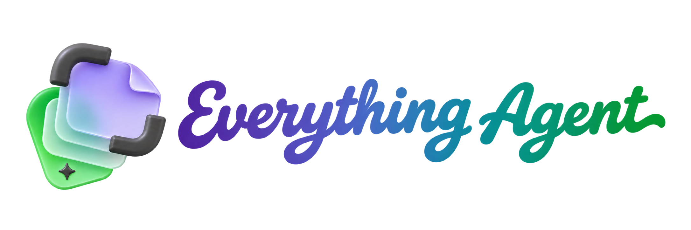
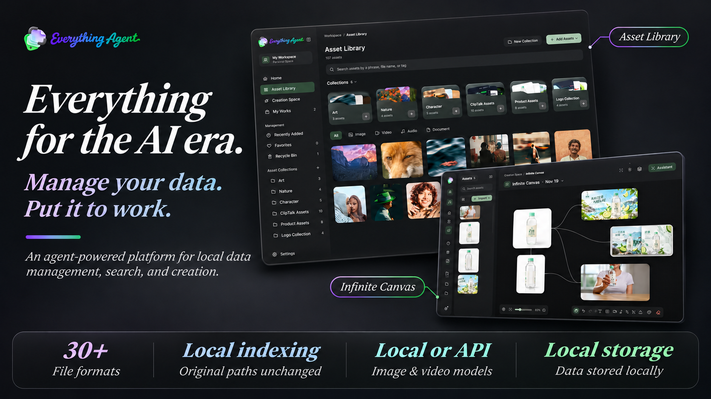
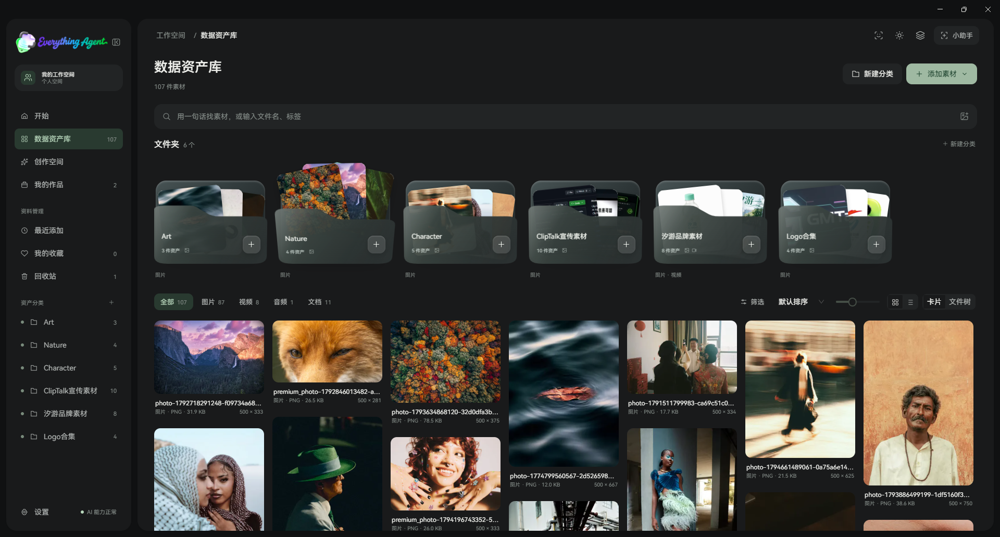
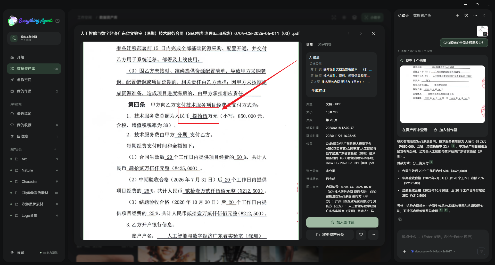
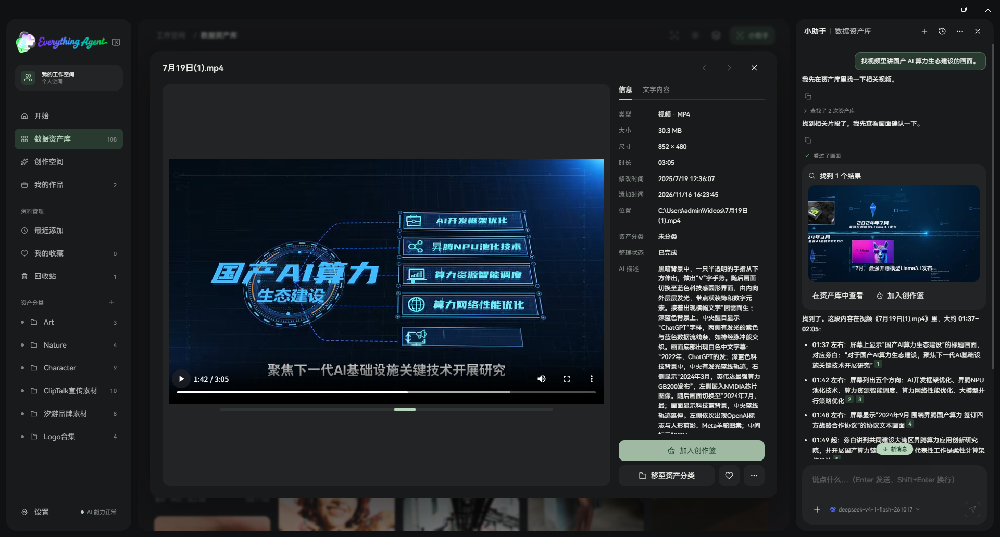
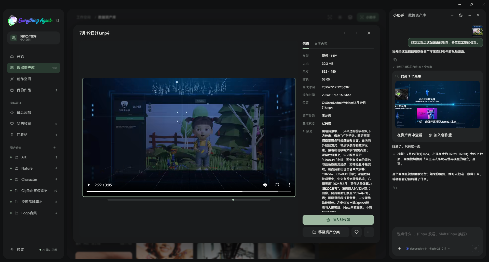
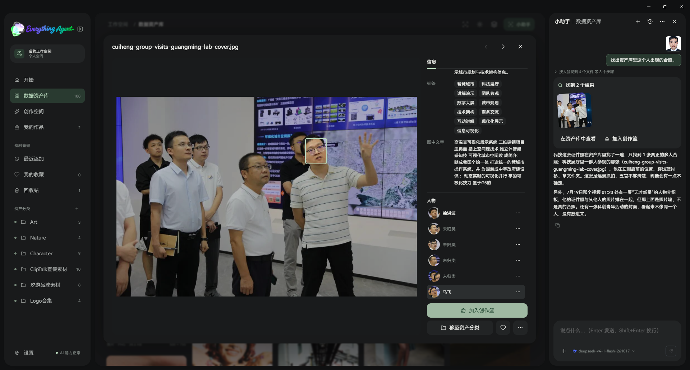
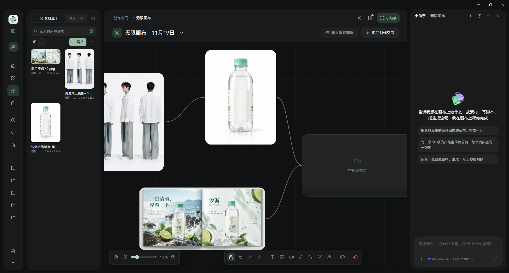
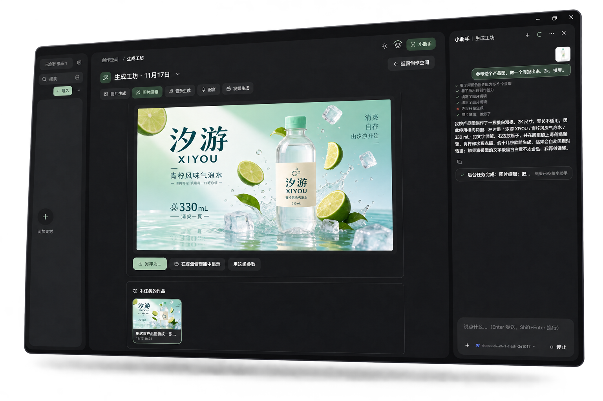

  

  <strong>AI 時代の Everything。</strong> エージェントがローカルデータの管理と活用を支援するプラットフォーム。ファイルの整理や情報の検索から、手元の素材を使った制作まで。

  

  <a href="./README.md">English</a> &nbsp; · &nbsp; <a href="./README.zh-CN.md">简体中文</a> &nbsp; · &nbsp; <strong>日本語</strong> &nbsp; · &nbsp; <a href="./README.ko.md">한국어</a>

  <a href="https://gml-mmgroup.github.io/Everything-Agent/">公式サイト</a> &nbsp; · &nbsp; <a href="https://github.com/GML-MMGroup/Everything-Agent/releases/latest">Windows 版をダウンロード</a> &nbsp; · &nbsp; <a href="https://github.com/GML-MMGroup/Everything-Agent/issues">フィードバック</a> &nbsp; · &nbsp; <a href="./LICENSE.txt">ライセンス</a>

## できること

- **30 種類以上のファイル形式を管理。** 画像・動画・音声・文書をコレクションに整理。AI が説明やタグを付け、音声の文字起こしや文書のテキスト抽出を行います。
- **覚えている手がかりから検索。** 自然言語で検索したり、文書に質問したり、1 枚の画像から動画の該当箇所を探したり、特定の人物が写った集合写真を見つけたりできます。
- **自分の素材で制作。** 無限キャンバスで素材をつなげることも、生成ワークショップでエージェントに生成タスクの設定と実行を任せることもできます。
- **元のファイルはそのまま。** ファイルを移動せずにインデックスを作成し、データはローカルに保存。画像・動画モデルはローカルでの実行と API 接続に対応しています。

## 自分に合った方法で素材を整理

素材をひとつのライブラリで管理し、コレクションに分類して内容をプレビュー。顔認識と人物ごとのグループ分けで、その人が登場する素材も探せます。

## 小さな手がかりから、必要な情報へ

質問、話題、動画の 1 コマ、人物の写真を手がかりに、エージェントが関連する素材と根拠を提示します。

| 文書に質問する                                                                                                                                                             | 動画の該当箇所を見つける                                                                                                                                           |
| :------------------------------------------------------------------------------------------------------------------------------------------------------------------------- | :----------------------------------------------------------------------------------------------------------------------------------------------------------------- |
|  |  |
| GEO システムの契約金額はいくらですか？                                                                                                                                     | 中国国内の AI 計算基盤エコシステムの構築について説明している動画の場面を探して。                                                                                   |

| 1 枚の画像から動画を探す                                                                                                                                             | その人が写った集合写真を探す                                                                                                                                           |
| :------------------------------------------------------------------------------------------------------------------------------------------------------------------- | :--------------------------------------------------------------------------------------------------------------------------------------------------------------------- |
|  |  |
| この画像が登場する動画を探して、どの位置に出てくるか教えて。                                                                                                         | この人が写っている集合写真をライブラリから探して。                                                                                                                     |

## 手元の素材から、次の作品へ

ライブラリの素材を制作スペースに取り込み、エージェントと一緒に手順を組み立て、新しい作品を作れます。

| 無限キャンバス                                                                                                                                                                 | 生成ワークショップ                                                                                                                                                                                               |
| :----------------------------------------------------------------------------------------------------------------------------------------------------------------------------- | :--------------------------------------------------------------------------------------------------------------------------------------------------------------------------------------------------------------- |
|  |  |
| 商品素材をポスターや動画の成果物につなげます。対話でノードを整理し、素材を接続してコンテンツを生成できます。                                                                   | やりたいことを伝えると、エージェントがツールを選び、パラメーターを設定して、画像・動画・音声を生成します。 <em>(パースによる紹介画像)</em>                                                                       |

## 使い始める

1. [最新リリース](https://github.com/GML-MMGroup/Everything-Agent/releases/latest)から Windows 用インストーラーをダウンロードします。
2. ローカルの素材を追加し、コレクションに整理します。
3. エージェントに検索を依頼するか、素材を制作スペースに取り込みます。

その他の事例は[公式サイト](https://gml-mmgroup.github.io/Everything-Agent/)をご覧ください。

## ライセンス

個人の非商用利用は無料です。商用利用には事前の書面による許諾が必要です。

詳細は[ライセンス全文](./LICENSE.txt)をご確認ください。商用ライセンスのお問い合わせは [xuhongbo@gml.ac.cn](mailto:xuhongbo@gml.ac.cn) まで。
