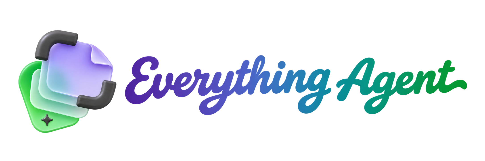
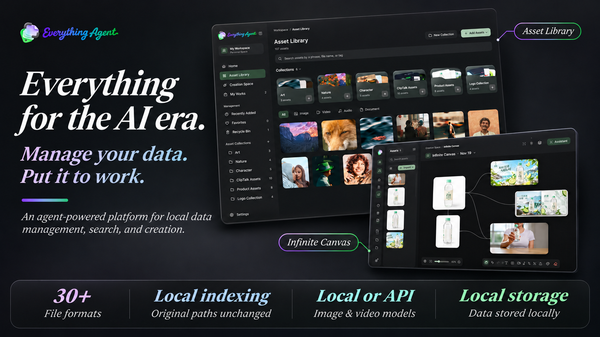
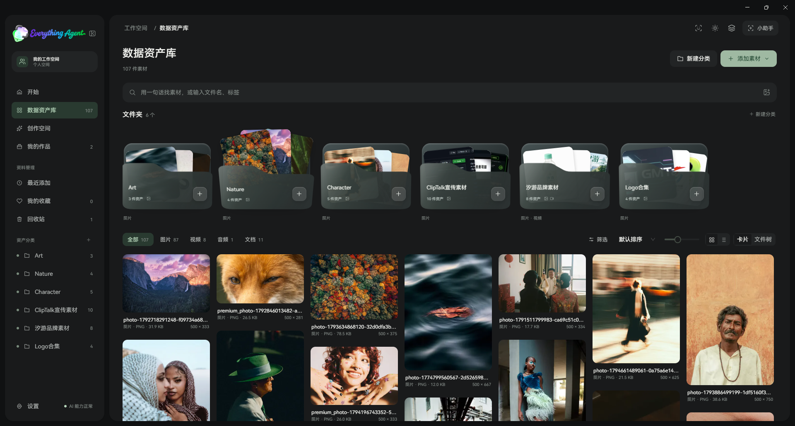
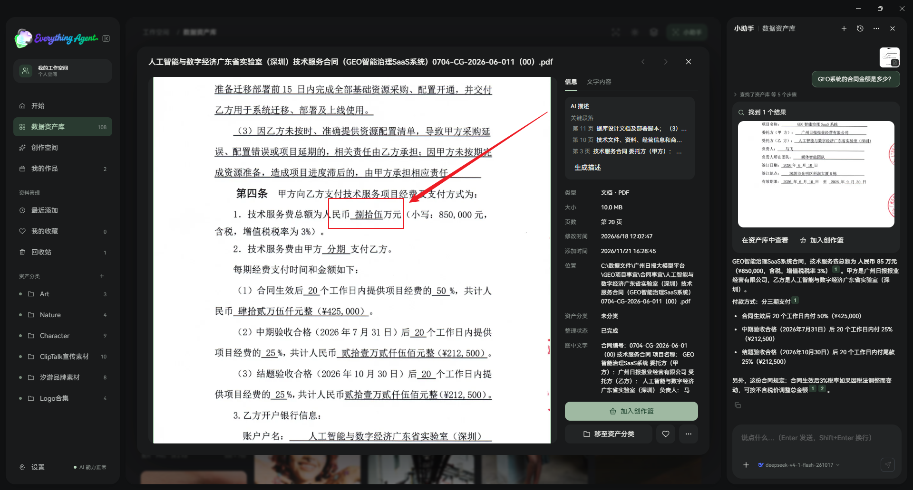
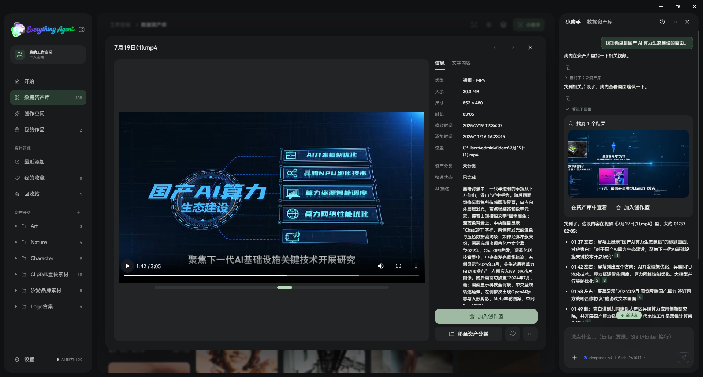
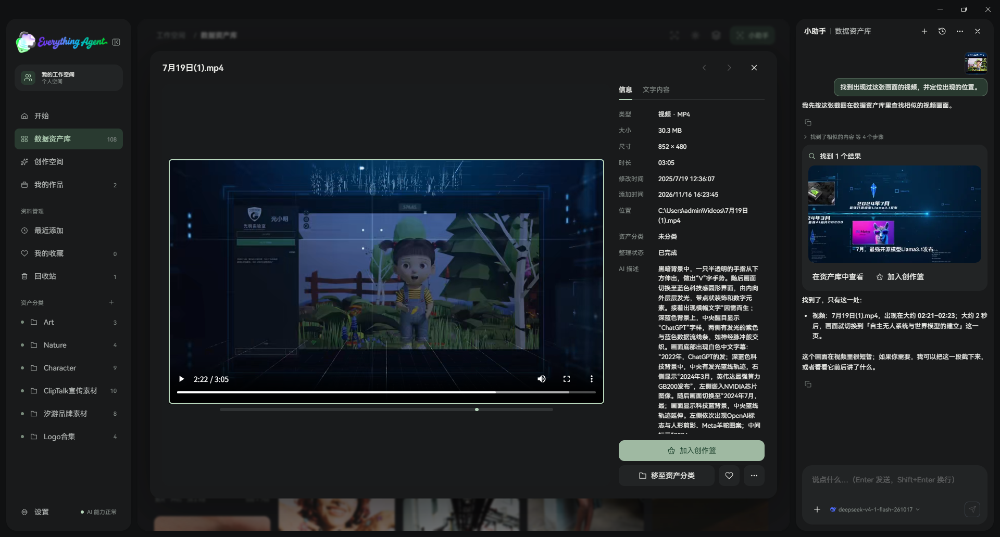
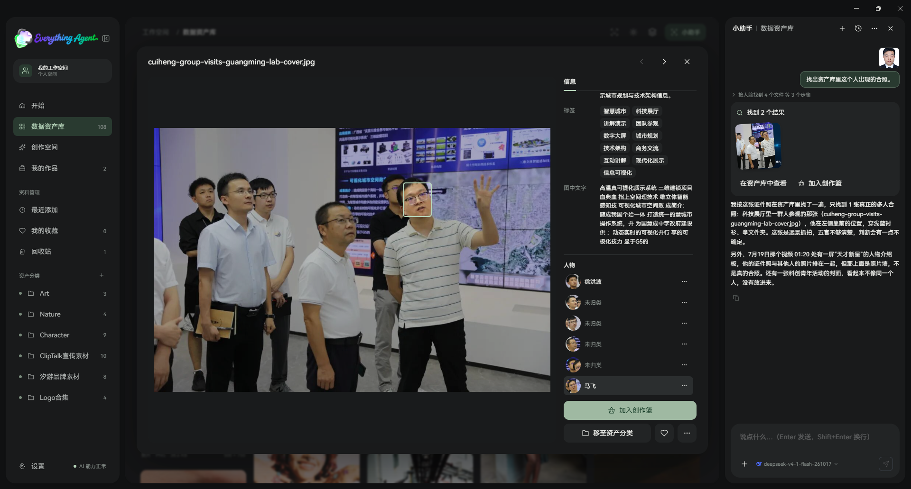
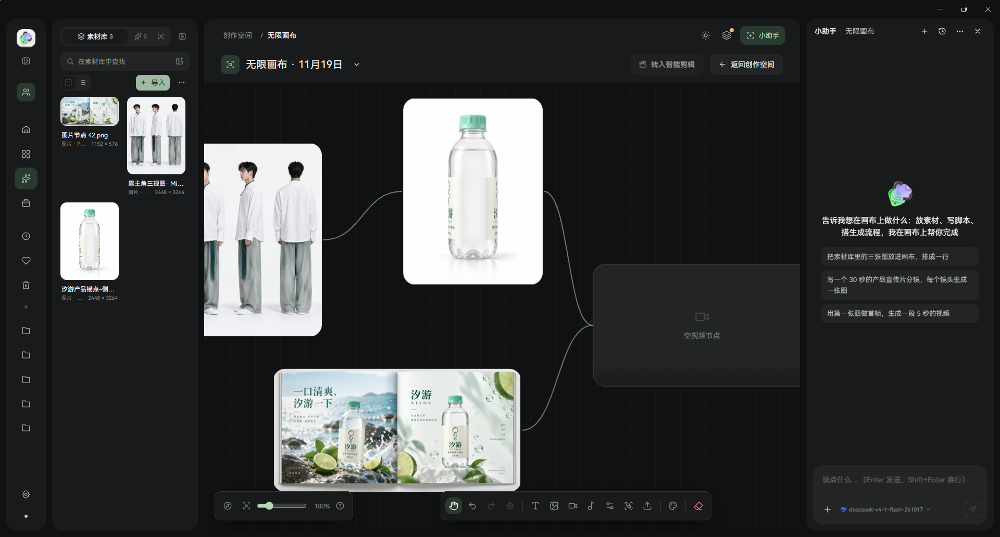

  

  <strong>AI 시대의 Everything.</strong> 에이전트 기반 로컬 데이터 관리·활용 플랫폼입니다. 파일 정리와 세부 정보 검색부터 보유한 자료를 활용한 창작까지 지원합니다.

  

  <a href="./README.md">English</a> &nbsp; · &nbsp; <a href="./README.zh-CN.md">简体中文</a> &nbsp; · &nbsp; <a href="./README.ja.md">日本語</a> &nbsp; · &nbsp; <strong>한국어</strong>

  <a href="https://gml-mmgroup.github.io/Everything-Agent/">공식 웹사이트</a> &nbsp; · &nbsp; <a href="https://github.com/GML-MMGroup/Everything-Agent/releases/latest">Windows 버전 다운로드</a> &nbsp; · &nbsp; <a href="https://github.com/GML-MMGroup/Everything-Agent/issues">피드백</a> &nbsp; · &nbsp; <a href="./LICENSE.txt">라이선스</a>

## 주요 기능

- **30종 이상의 파일 형식 관리.** 이미지, 동영상, 오디오, 문서를 컬렉션으로 정리합니다. AI가 설명과 태그를 생성하고, 음성을 전사하며, 문서의 텍스트를 추출합니다.
- **기억나는 단서로 검색.** 자연어로 검색하거나 문서에 질문할 수 있습니다. 스크린샷으로 동영상의 특정 장면을 찾고, 특정 인물이 등장하는 단체 사진도 검색할 수 있습니다.
- **내 자료로 창작.** 무한 캔버스에서 자료를 연결하거나 생성 워크숍에서 에이전트에게 생성 작업의 설정과 실행을 맡길 수 있습니다.
- **원본 파일 위치 유지.** 파일을 이동하지 않고 인덱싱하며 데이터는 로컬에 저장합니다. 이미지·동영상 모델은 로컬 배포와 API 연결을 지원합니다.

## 나만의 방식으로 자료 정리

여러 자료를 하나의 라이브러리에서 관리하고 컬렉션으로 분류해 미리 볼 수 있습니다. 얼굴 인식과 인물별 분류를 통해 특정 인물이 등장하는 자료도 찾을 수 있습니다.

## 작은 단서로 필요한 자료 찾기

질문, 주제, 영상의 한 장면, 인물 사진에서 시작하세요. 에이전트가 관련 자료를 찾아 근거와 함께 보여 줍니다.

| 문서에 질문하기                                                                                                                                                           | 동영상의 특정 구간 찾기                                                                                                                                                   |
| :------------------------------------------------------------------------------------------------------------------------------------------------------------------------ | :------------------------------------------------------------------------------------------------------------------------------------------------------------------------ |
|  |  |
| GEO 시스템의 계약 금액은 얼마인가요?                                                                                                                                      | 중국의 자국 AI 컴퓨팅 생태계 구축을 설명하는 동영상 장면을 찾아 주세요.                                                                                                   |

| 스크린샷으로 동영상 찾기                                                                                                                                                | 특정 인물이 나온 단체 사진 찾기                                                                                                                                     |
| :---------------------------------------------------------------------------------------------------------------------------------------------------------------------- | :------------------------------------------------------------------------------------------------------------------------------------------------------------------ |
|  |  |
| 이 장면이 나오는 동영상을 찾고 등장하는 위치를 알려 주세요.                                                                                                             | 라이브러리에서 이 사람이 등장하는 단체 사진을 찾아 주세요.                                                                                                          |

## 내 자료로 다음 작품 만들기

라이브러리의 자료를 창작 공간으로 가져와 에이전트와 함께 작업 흐름을 구성하고 새로운 결과물을 만드세요.

| 무한 캔버스                                                                                                                                                                           | 생성 워크숍                                                                                                                                                                                                      |
| :------------------------------------------------------------------------------------------------------------------------------------------------------------------------------------ | :--------------------------------------------------------------------------------------------------------------------------------------------------------------------------------------------------------------- |
|  |  |
| 제품 자료를 포스터와 동영상 결과물로 연결합니다. 대화로 노드를 정리하고 자료를 연결하며 콘텐츠를 생성할 수 있습니다.                                                                  | 원하는 작업을 설명하면 에이전트가 도구를 선택하고 매개변수를 설정해 이미지, 동영상 또는 오디오를 생성합니다. <em>(원근 표현 미리보기)</em>                                                                       |

## 시작하기

1. [최신 릴리스](https://github.com/GML-MMGroup/Everything-Agent/releases/latest)에서 Windows 설치 파일을 다운로드하세요.
2. 로컬 자료를 추가하고 컬렉션으로 정리하세요.
3. 에이전트에게 검색을 요청하거나 자료를 창작 공간으로 가져오세요.

더 많은 사례는 [공식 웹사이트](https://gml-mmgroup.github.io/Everything-Agent/)에서 확인하세요.

## 라이선스

개인의 비상업적 사용은 무료입니다. 상업적 사용에는 사전 서면 허가가 필요합니다.

자세한 내용은 [라이선스 전문](./LICENSE.txt)을 확인하세요. 상업용 라이선스 문의: [xuhongbo@gml.ac.cn](mailto:xuhongbo@gml.ac.cn).
