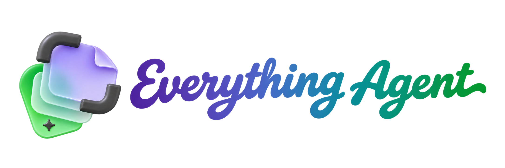
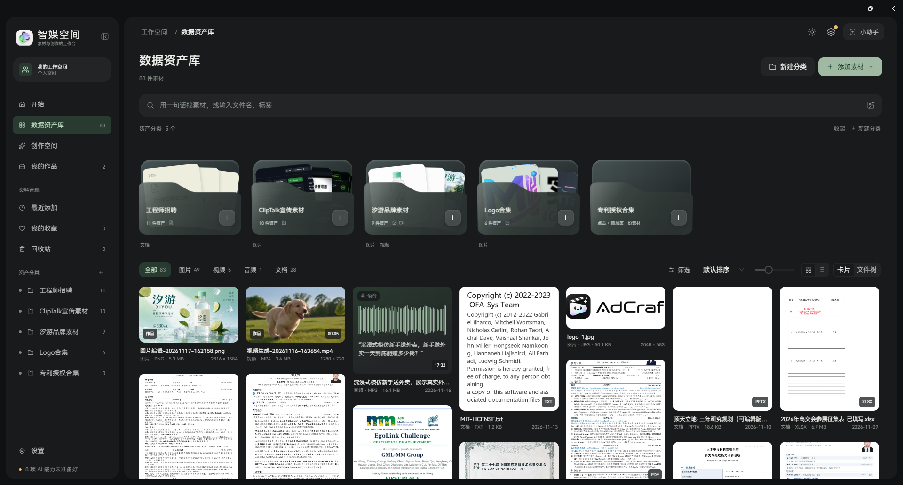
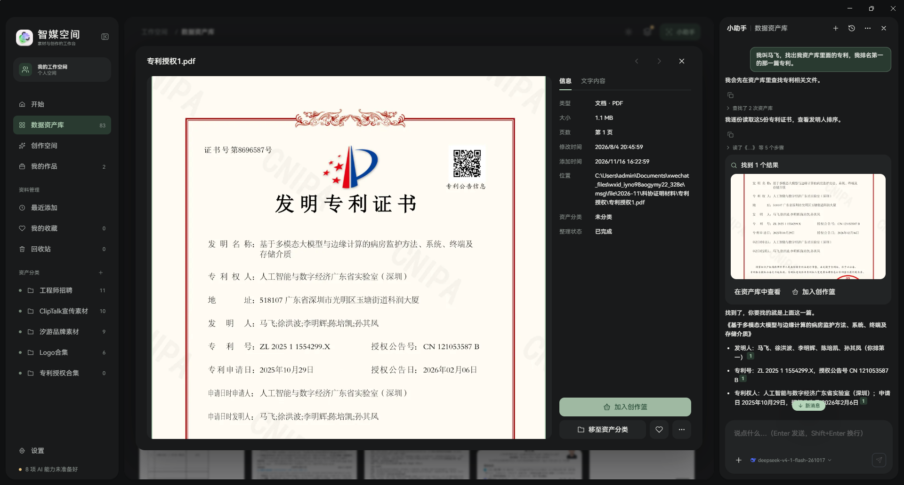
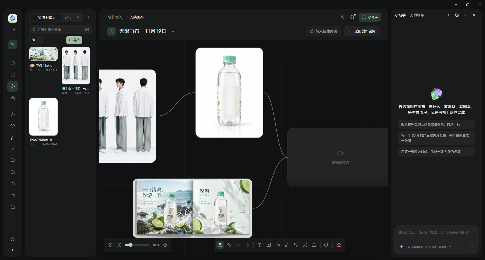

  

  <strong>Everything for the AI era.</strong>

  An agent-powered platform for managing and using your local data.

  <a href="https://github.com/GML-MMGroup/Everything-Agent/releases">Windows Releases</a>
  &nbsp; · &nbsp;
  <a href="https://github.com/GML-MMGroup/Everything-Agent/issues">Feedback</a>
  &nbsp; · &nbsp;
  <a href="./LICENSE.txt">License</a>

## Organize your files

Bring images, videos, audio, and documents into one library.
Keep their original locations, organize them into collections,
and let AI index their content.

## Find what you remember

Describe what you need. Find an order by its amount, a person in
group photos, or the exact moment a screenshot appears in a video.
Ask questions about your documents and get answers from their content.

## Create with your own assets

Bring your assets onto an infinite canvas or into the generation
workshop. Describe your idea, let the agent build it, and refine
the result through conversation.

## License

Free for personal, non-commercial use.
Commercial use requires prior written authorization.

See the [full license](./LICENSE.txt).
For commercial licensing, contact [xuhongbo@gml.ac.cn](mailto:xuhongbo@gml.ac.cn).
