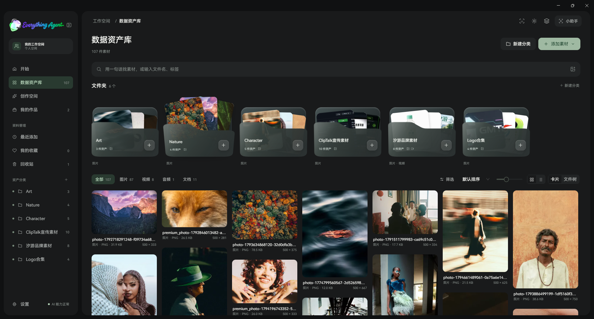
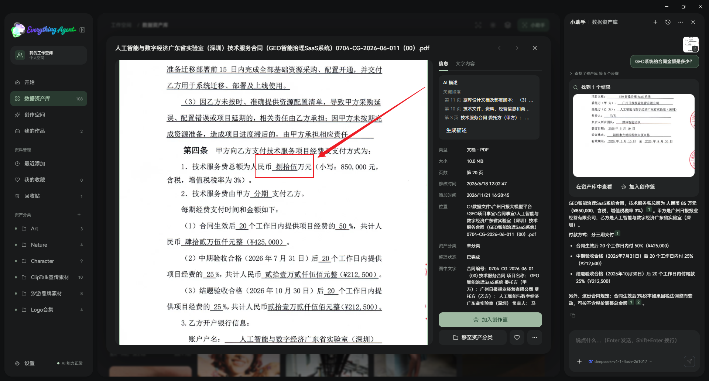

  

  <strong>Everything for the AI era.</strong> 
  An agent-powered platform for managing and using your local data — from organizing files and finding details to creating with your own assets.

  

  <strong>English</strong> &nbsp; · &nbsp; <a href="./README.zh-CN.md">简体中文</a> &nbsp; · &nbsp; <a href="./README.ja.md">日本語</a> &nbsp; · &nbsp; <a href="./README.ko.md">한국어</a>

  <a href="https://gml-mmgroup.github.io/Everything-Agent/">Website</a> &nbsp; · &nbsp; <a href="https://github.com/GML-MMGroup/Everything-Agent/releases/latest">Download for Windows</a> &nbsp; · &nbsp; <a href="https://github.com/GML-MMGroup/Everything-Agent/issues">Feedback</a> &nbsp; · &nbsp; <a href="./LICENSE.txt">License</a>

## What you can do

- **Manage 30+ file formats.** Organize images, videos, audio, and documents in collections; AI adds descriptions, tags, transcripts, and extracted text.
- **Find what you remember.** Search with natural language, ask a document a question, locate a video from a frame, or find photos featuring a person.
- **Create with your own assets.** Connect materials on Infinite Canvas or let the agent configure a task in Generation Workshop.
- **Keep control of your library.** Index files without moving the originals. Data is stored locally; image and video models support local deployment or API access.

## Organize your files

Bring your assets into one library, organize them into collections, and preview their contents. Face recognition and grouping also let you browse assets by person.

## Find what you remember

Start with a question, a topic, a frame, or a face. The agent finds the relevant assets and shows the result in context.

| Ask your documents                                                                                                                                                                    | Locate a video segment                                                                                                                                                                     |
| :------------------------------------------------------------------------------------------------------------------------------------------------------------------------------------ | :----------------------------------------------------------------------------------------------------------------------------------------------------------------------------------------- |
|  |  |
| What is the contract amount for the GEO system?                                                                                                                                       | Find the segment about building China’s domestic AI computing ecosystem.                                                                                                                   |

| Find a video from a frame                                                                                                                                                         | Find group photos                                                                                                                                                                |
| :-------------------------------------------------------------------------------------------------------------------------------------------------------------------------------- | :------------------------------------------------------------------------------------------------------------------------------------------------------------------------------- |
|  |  |
| Find the video containing this frame and show me where it appears.                                                                                                                | Find group photos featuring this person.                                                                                                                                         |

## Create with your own assets

Turn materials from your library into new work, with the agent helping you organize the process.

| Infinite Canvas                                                                                                                                                                                   | Generation Workshop                                                                                                                                                                                                                 |
| :------------------------------------------------------------------------------------------------------------------------------------------------------------------------------------------------ | :---------------------------------------------------------------------------------------------------------------------------------------------------------------------------------------------------------------------------------- |
|  |  |
| Connect product assets to poster and video results on a canvas. Use conversation to organize nodes, connect materials, and generate content.                                                      | Describe the task. The agent selects tools, fills in parameters, and generates an image, video, or audio result. <em>(Perspective preview)</em>                                                                                     |

## Get started

1. Download the Windows installer from the [latest release](https://github.com/GML-MMGroup/Everything-Agent/releases/latest).
2. Add local assets to your library and organize them into collections.
3. Ask the agent to find something, or bring your assets into a creation workspace.

Explore more examples on the [product website](https://gml-mmgroup.github.io/Everything-Agent/).

## License

Free for personal, non-commercial use. Commercial use requires prior written authorization.

See the [full license](./LICENSE.txt). For commercial licensing, contact [xuhongbo@gml.ac.cn](mailto:xuhongbo@gml.ac.cn).
