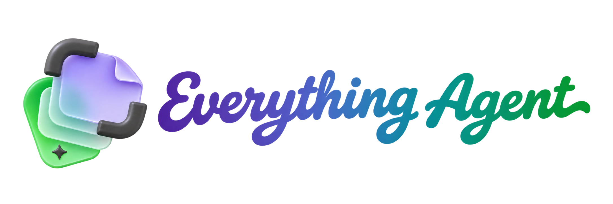
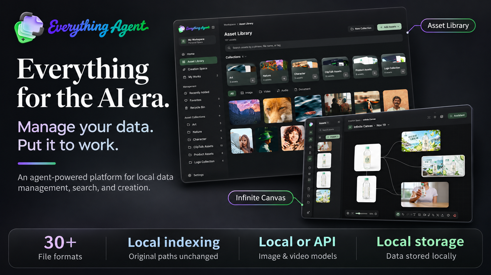
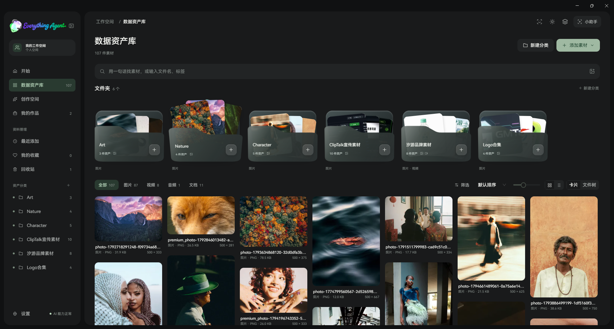
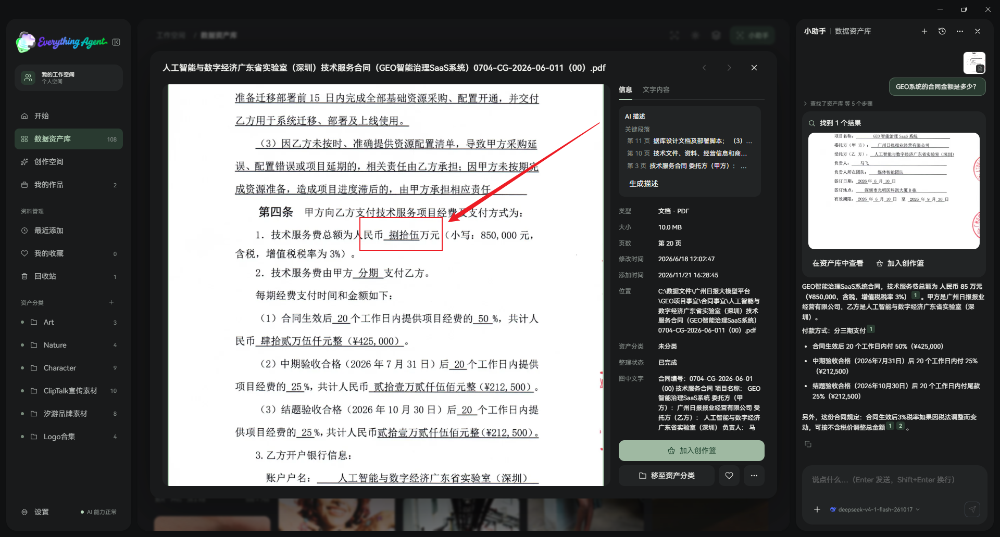
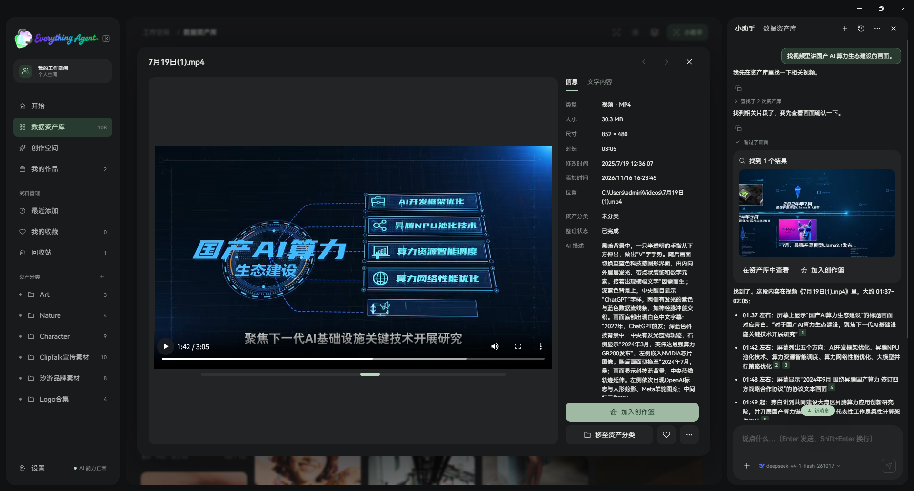
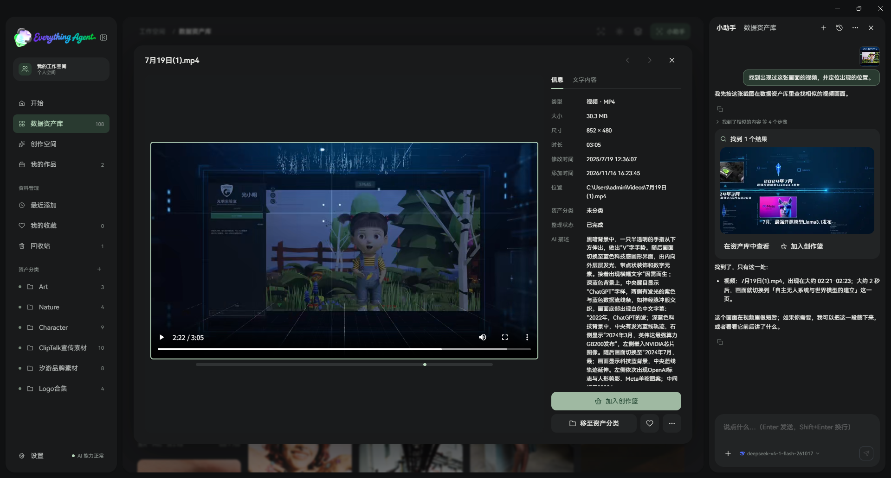
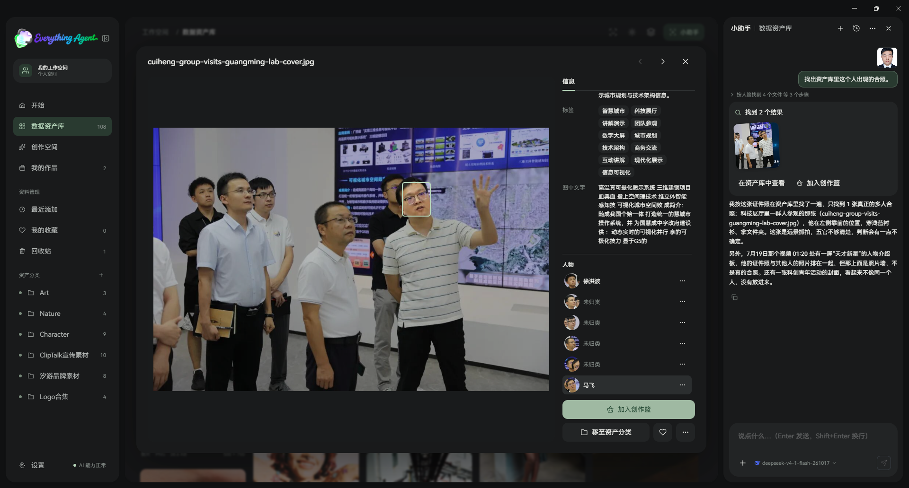
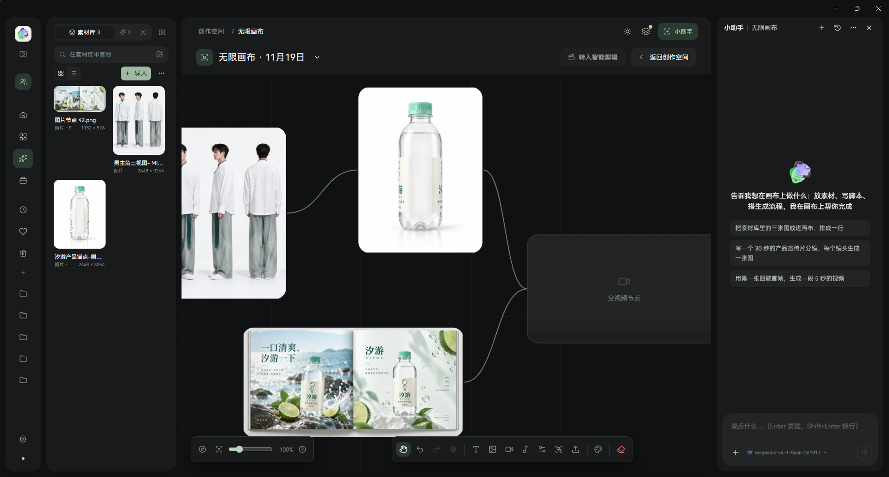
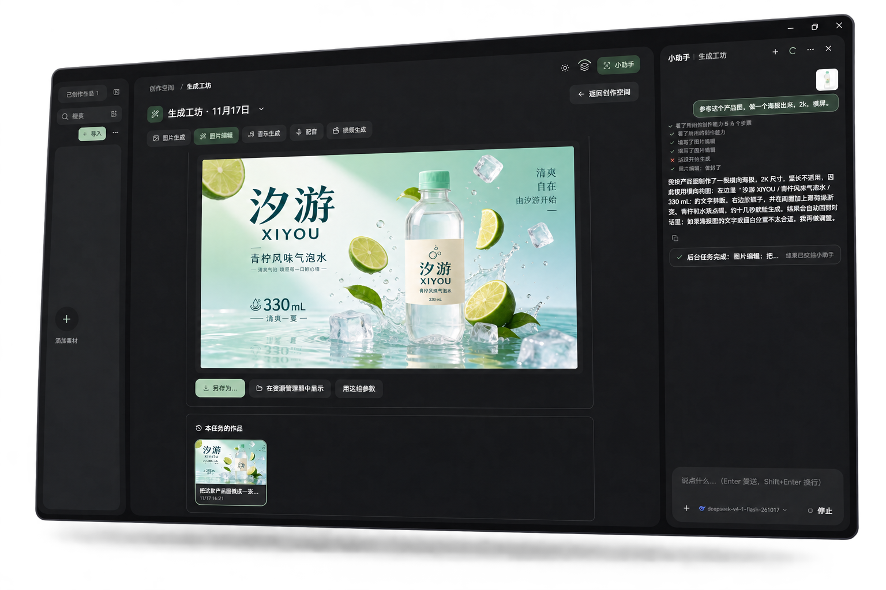

  

  

  <a href="./README.md">English</a> &nbsp; · &nbsp; <strong>简体中文</strong> &nbsp; · &nbsp; <a href="./README.ja.md">日本語</a> &nbsp; · &nbsp; <a href="./README.ko.md">한국어</a>

  <a href="https://gml-mmgroup.github.io/Everything-Agent/">产品官网</a> &nbsp; · &nbsp; <a href="https://github.com/GML-MMGroup/Everything-Agent/releases/latest">下载 Windows 版</a> &nbsp; · &nbsp; <a href="https://github.com/GML-MMGroup/Everything-Agent/issues">问题反馈</a> &nbsp; · &nbsp; <a href="./LICENSE.txt">许可</a>

**AI 时代的 Everything。** Agent 驱动的本地数据管理与数据应用平台，从整理文件、查找细节，到用自己的素材完成创作。

## 你可以用它做什么

- **管理 30+ 种文件格式。** 图片、视频、音频和文档按分类组织，AI 自动生成描述、标签、转录文字与文档提取内容。
- **从线索找到素材。** 用自然语言检索，向文档提问，以截图定位视频，或查找某个人出现的合照。
- **用自己的素材创作。** 在无限画布中连接素材，或让 Agent 在生成工坊中配置并完成生成任务。
- **掌握自己的资产库。** 本地索引不改变原始文件位置，数据存储在本地；图片和视频模型支持本地部署或 API 接入。

## 按你的方式，组织素材

把素材放入同一个资产库，按分类整理并预览内容。人物识别与人脸归类，让你也能按人物查找相关素材。

## 记得一点线索，就能开始找

从一个问题、一个话题、一张截图或一张人像开始，让 Agent 找到对应素材并展示依据。

| 文档细节，一问便知                                                                                                                                       | 音视频细节，精准定位                                                                                                                                             |
| :------------------------------------------------------------------------------------------------------------------------------------------------------- | :--------------------------------------------------------------------------------------------------------------------------------------------------------------- |
|  |  |
| GEO 系统的合同金额是多少？                                                                                                                               | 找视频里讲国产 AI 算力生态建设的画面。                                                                                                                           |

| 一张截图，找到对应视频                                                                                                                                    | 找到这个人出现的合照                                                                                                                                |
| :-------------------------------------------------------------------------------------------------------------------------------------------------------- | :-------------------------------------------------------------------------------------------------------------------------------------------------- |
|  |  |
| 找到出现过这张画面的视频，并定位出现的位置。                                                                                                              | 找出资产库里这个人出现的合照。                                                                                                                      |

## 用自己的素材，完成下一件作品

把资产库里的素材带入创作空间，让 Agent 协助组织流程、生成新的作品。

| 无限画布                                                                                                                                                           | 生成工坊                                                                                                                                                                                     |
| :----------------------------------------------------------------------------------------------------------------------------------------------------------------- | :------------------------------------------------------------------------------------------------------------------------------------------------------------------------------------------- |
|  |  |
| 将产品素材连接到海报与视频结果，通过对话组织节点、连接素材并生成内容。                                                                                             | 说出需求，Agent 选择工具、填写参数，生成图像、视频或音频。 <em>(透视效果展示)</em>                                                                                                           |

## 开始使用

1. 从[最新 Release](https://github.com/GML-MMGroup/Everything-Agent/releases/latest) 下载 Windows 安装包。
2. 导入本地素材，并按需要建立分类。
3. 让 Agent 查找素材，或把素材带入创作空间。

更多案例见[产品官网](https://gml-mmgroup.github.io/Everything-Agent/)。

## 许可

个人非商业使用免费。商业使用须事先取得书面授权。

请阅读[完整许可](./LICENSE.txt)。商业授权请联系 [xuhongbo@gml.ac.cn](mailto:xuhongbo@gml.ac.cn)。
